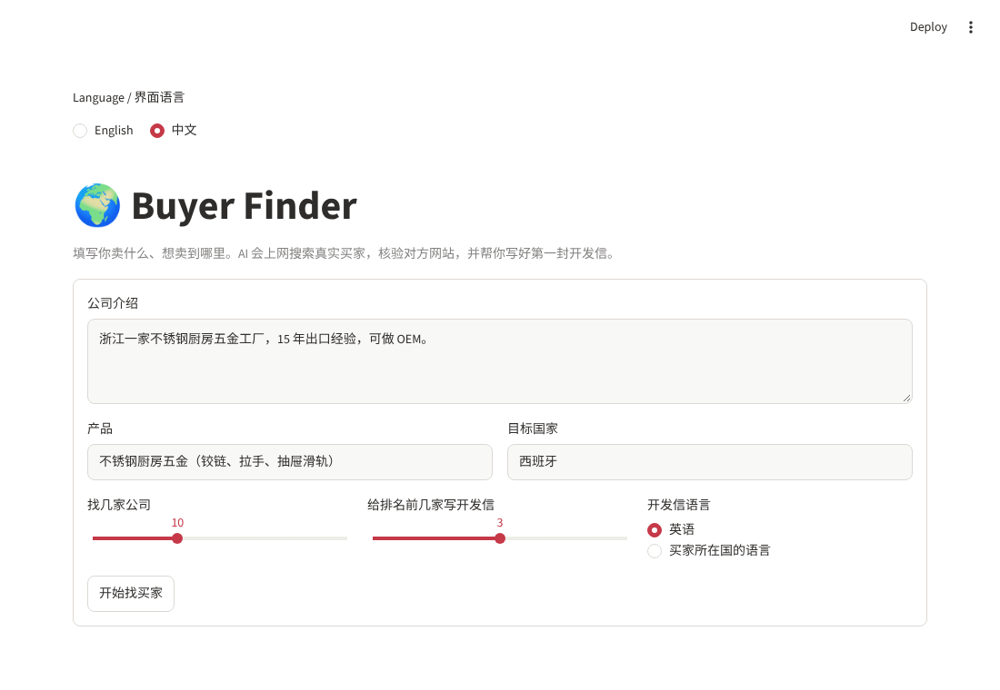

# 🌍 Buyer Finder

An AI agent that helps small exporters find overseas buyers.
Describe what you sell and which country you want to sell into. The agent searches the web for real importers and distributors, ranks them by fit, and drafts a first email to the best ones.



## Why I built this

【用你自己的话写 3–4 句：你认识的浙江外贸人找客户有多费劲（展会名片跟进不了、开发信没人回、一家家搜公司很花时间），你为什么想用 AI 解决这个问题】

## How it works

1. **Research.** The agent searches the web for companies in the target country that already sell similar products, and returns them as a table: name, website, city, type, what they sell, why they fit, a fit score from 1 to 5, and the source link.
2. **Filter.** Competing manufacturers, B2B marketplaces (Alibaba, Made-in-China…), directories, social media and job sites are removed, so only real buyers stay. Each company gets an intent level (very high / high / medium / low) and a next-step tip.
3. **Verify.** Every website is opened automatically. Dead or made-up links are flagged, and companies with working websites move to the top.
4. **Draft.** For the top verified companies, the agent writes a short first email that mentions something specific about that company, in English or in the buyer's own language.
5. **Export.** Download the list as a CSV to use in Excel or a CRM. Each row has a LinkedIn search link to find the buyer at that company.

Buyer Finder never sends emails by itself. You read the drafts and decide what to send.

Each run also shows an **estimated cost** (searches and tokens), and results stay on the page when you download the CSV.

The interface works in both **English and Chinese**, because many of the exporters who need this tool are more comfortable in Chinese.

The agent is told to include only companies it found evidence for, and every row comes with a source link so you can check it.

## Run it yourself

Buyer Finder works with two AI setups. Switch with one setting, no code changes.

| Setting | Search | Model | Cost per run |
|---|---|---|---|
| `deepseek` (default) | DeepSeek Search API (or [SerpAPI](https://serpapi.com) if you prefer) | DeepSeek Flash | about $0.01 |
| `claude` | Claude's built-in web search | Claude Haiku 5.5 | about $0.06 |

```bash
git clone https://github.com/hailey-studio/buyer-finder.git
cd buyer-finder
pip install -r requirements.txt

# DeepSeek setup: one key does both search and the model
export BUYER_FINDER_PROVIDER=deepseek
export DEEPSEEK_API_KEY="your-deepseek-key"

# or Claude setup
# export BUYER_FINDER_PROVIDER=claude
# export ANTHROPIC_API_KEY="your-claude-key"

streamlit run app.py
```

A browser tab opens. Fill in your company, product and target country, then click **Find buyers**. Each run shows its estimated cost.

To deploy on Streamlit Community Cloud, put the same values in the app's **Secrets**, plus a password:

```toml
BUYER_FINDER_PROVIDER = "deepseek"
DEEPSEEK_API_KEY = "your-deepseek-key"
APP_PASSWORD = "choose-a-password"
```

## Learned from

I studied open-source tools that solve similar problems and borrowed what works:
[b2b-buyer-discovery](https://github.com/Tommy-old/b2b-buyer-discovery) and [dsh-waimao](https://github.com/shine-233/dsh-waimao) (filtering out non-buyers, intent levels, Spanish emails for Latin America),
[OpenOutreach](https://github.com/eracle/OpenOutreach) (a plain-language reason for every lead),
[company-research-agent](https://github.com/guy-hartstein/company-research-agent) (source-backed research).
Buyer Finder aims to be the simplest of these to use: one web page, in Chinese or English, with no setup for the end user.

## Limitations

- Web search can miss companies that have little online presence, and it can't verify emails or phone numbers.
- Always check each company's website and source before reaching out.
- Built for a first list, not for sending emails at scale.

## Built with

Python · Streamlit · [DeepSeek API](https://api-docs.deepseek.com) (model + search) or [Claude API](https://docs.claude.com)

Built by Hailey Qiu, with Claude as a coding assistant.
